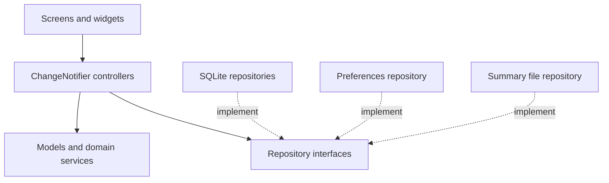

# Movement Quest Architecture

Movement Quest is a local-first Flutter application for creating workout plans,
recording exercise sets, reviewing training history, and saving preferences.
Jeremy Henry-Atohengbe developed the project individually.

The application stores its data on the device. It does not use cloud
authentication, a remote database, or a recommendation API.

## Application structure

The implementation separates presentation, state coordination, domain rules,
and persistence.

| Layer | Responsibilities |
|---|---|
| Screens and widgets | Display state, collect input, show validation and recovery controls |
| Controllers | Coordinate loading and mutations, expose state, notify listeners |
| Models and services | Validate records, group sessions, calculate summaries and recommendations |
| Repository interfaces | Define the storage operations controllers require |
| Data implementations | Perform SQLite, preference, and local-file operations |

Widgets do not execute SQL. Controllers depend on repository contracts so tests
can supply fake implementations without opening a device database.

## Startup and dependency injection

`lib/main.dart` initializes Flutter and starts the application.

The startup wrapper loads SharedPreferences before constructing dependencies.
It provides loading, timeout, error, and Retry states rather than leaving a
startup failure without an explanation.

Provider supplies the database, repository implementations, and shared
controllers. Workout and preference controllers use ChangeNotifier to notify
listening widgets when their state changes.

The dependency direction is:

1. A widget collects an action.
2. A controller validates and coordinates the operation.
3. A repository implementation reads or changes local storage.
4. The controller refreshes its state and notifies listeners.
5. The widget rebuilds from the current state.

Tests can replace the concrete repositories while exercising the same
controller behavior.

## Screen responsibilities

The application has five main screen roles.

| Screen role | Responsibility |
|---|---|
| Workout catalog | Display plans, filter by equipment, and access Gear Match |
| Workout editor | Create and update validated workout plans |
| Workout details and activity | Display a plan and manage its active session |
| Training History | Group saved sets into sessions and manage saved records |
| Settings | Save preferences and manage the daily reminder |

The main navigation contains Workouts, History, and Settings. The editor and
details screens are opened from the workout workflow.

Reusable StatelessWidgets display supplied values and expose callbacks.
StatefulWidgets own temporary input, text controllers, dialogs, and animations.

## Data model

### WorkoutPlan

A workout plan contains:

- An optional ID before insertion.
- A title.
- An equipment tag.
- An optional plan note.
- An effort preference from 1 through 5.

The supported equipment tags are None, Dumbbells, and Band. Text values are
trimmed and validated before persistence.

### TrainingLog

A training log represents one exercise set. It contains:

- An optional ID before insertion.
- The related workout ID.
- A stable session key.
- A session label.
- An exercise label.
- A positive whole-number repetition count.
- A timestamp.
- A session completion flag.

One workout can have many training-log rows.

### TrainingSession

TrainingSession groups log rows by session key for presentation and
calculations. It is a derived model rather than a separate SQLite entity.

The group provides session information, set count, and total repetitions.
A completed-session count counts sessions, not individual set rows.

## SQLite persistence

`lib/data/app_database.dart` owns database creation and connection setup.

The database enables foreign keys. Training logs reference their parent
workout, and deleting a workout cascades to its related logs.

Database constraints supplement model and form validation. Repository
operations use parameterized queries. Transactions protect operations that
require a consistent read and write.

The repository contracts are:

- `lib/repositories/workout_repository.dart`
- `lib/repositories/training_log_repository.dart`

Their SQLite implementations are:

- `lib/data/sqlite_workout_repository.dart`
- `lib/data/sqlite_training_log_repository.dart`

The UI asks for confirmation before destructive actions.

## Session lifecycle

Starting a session creates one stable session key. Every saved set in that
session uses the same identity.

A session without saved sets exists only in memory. It does not create an
empty history entry.

Adding a valid set creates a TrainingLog row. Decimal, zero, and negative
repetition values are rejected.

Finishing a session updates its existing rows to completed. It does not insert
an additional completion row.

Resetting an active session requires confirmation and removes only its
unfinished rows. Completed history remains stored.

An unfinished session with saved sets can be restored when its plan is
reopened after restarting the app.

Editing a saved set preserves its identity and session relationship. Renaming
a session updates the shared label across its rows.

Deleting one set leaves the session visible if other rows remain. Deleting
the final set removes that session from the derived history.

## Controller ownership

WorkoutController and PreferencesController provide shared application state.

Session, history, and reminder controllers are owned by the screens or panels
that create them. Those owners dispose their controllers when removed.

Controllers expose loading, saving, success, and error state. Busy guards
prevent overlapping mutations.

Async callbacks check whether their owner is still active before updating
widget state. Text and animation controllers are disposed by their widgets.

When a storage result is uncertain, recovery reloads the stored state before
allowing another mutation.

## Preferences

SharedPreferences stores the small AppPreferences object as versioned JSON.

Preferences include:

- An optional equipment preference.
- A default effort preference.

A null equipment preference means no preference. The None equipment tag means
a workout that requires no equipment.

New workout forms inherit the saved default effort. Existing workout plans
retain their own effort values when edited.

Settings do not silently rewrite saved workout plans.

## Gear Match

Gear Match is a deterministic local rule-based helper. It is not a trained
machine-learning model.

It uses saved plans, an equipment preference, and completed training history.

The scoring rules are:

- Add 2 points for matching the equipment preference.
- Add 1 point for differing from the most recently completed session's plan.
- Resolve equal scores using the lowest saved plan ID.

Without an equipment preference, equipment points are omitted. Without
completed history, the recent-session bonus is omitted.

Recent completed sessions are identified by grouping their sets and comparing
each group's latest timestamp. Equal timestamps use ascending session key.

The output explains the applied rules. View plan opens the suggested plan
without automatically starting a session. Not now allows the user to dismiss
the result.

Empty and invalid inputs produce feedback instead of an unsupported
recommendation.

The score is not a confidence estimate, fitness assessment, or medical
recommendation.

### Evaluation

The equipment-only baseline uses equipment scoring and the same plan-ID
tie-break, but omits the recent-session rule.

Five held-out synthetic cases produced:

| Method | Reference matches | Runtime errors |
|---|---:|---:|
| Gear Match | 5 of 5 | 0 |
| Equipment-only baseline | 3 of 5 | 0 |

The evaluation checks agreement with frozen rule-based references. It does not
establish real-user preference or fitness outcomes.

Evaluation artifacts are stored in:

- `evaluation/gear_match_held_out.json`
- `tool/evaluate_gear_match.dart`
- `evaluation/gear_match_results.json`

## Summary calculation and local files

TrainingSummaryService performs summary calculations through Isolate.run.

The main isolate reads logs and converts them to plain maps. The worker groups
sessions and calculates totals, then returns a versioned summary.

Database access remains outside the worker. The isolate does not continue
running as a background service after the app closes.

LocalSummaryFileRepository saves `training_summary.json` in the application's
documents directory.

Reading validates the file's version, structure, timestamp, and totals.
Missing or malformed files produce feedback.

A saved summary is a snapshot. It can differ from later history. Reading it
does not import records or change the SQLite database.

## Animations

AnimatedSummaryTotals demonstrates both animation approaches:

- AnimatedContainer provides an implicit styling transition.
- AnimationController drives an explicit fade and slide transition.

Reduced-motion settings skip the entrance effect. The widget disposes its
animation controller when removed.

Still screenshots show the resulting appearance; they do not demonstrate
motion.

## Android reminders

AndroidReminderService manages one timezone-aware daily local reminder.

Permission is requested when saving a schedule. Updating reuses notification
ID 1001 to replace the existing schedule. Cancellation removes that reminder.

Scheduling uses the device timezone and calculates a future occurrence.
The application uses inexact scheduling, so Android may deliver later than
the selected time.

A supplied phone screenshot confirms notification delivery. It does not
measure delivery delay or prove absence after cancellation.

Tests cover reminder-controller behavior and time calculations, including
midnight and daylight-saving boundaries.

## Error handling

The application provides feedback for:

- Invalid form input.
- Empty catalogs and filters without matches.
- Loading and storage failures.
- Missing or malformed summary files.
- Notification permission denial.
- Startup failures.
- Unsaved changes before leaving the editor.

Recovery controls allow retrying or reloading where appropriate. Failed or
uncertain operations are not presented as successful saves.

## Testing and current verification status

Unit tests exercise validation, grouping, helper rules, controller behavior,
and reminder-time calculations.

Widget tests exercise rendering, navigation, form interactions, state
transitions, and lifecycle behavior using controlled dependencies.

Temporary-file tests exercise summary persistence.

The local unit and widget tests passed. The coverage run generated
`coverage/lcov.info`. No coverage percentage is claimed here.

Manual testing on an Android phone passed the reported plan, preference,
session, history, summary, and deletion workflows. The tester also confirmed
that a saved plan and setting remained after closing and reopening the app
with networking disabled.

The automated Android integration suite was written but could not be
executed. Emulator setup initially encountered a missing system image and
insufficient space on C:. After installing the image and moving virtual-device
data to D:, emulator launches still crashed or remained offline.

The underlying emulator startup problem remains unresolved. It is an
execution-environment blocker, not a failed application assertion or a
passing integration result.

Verification on a second Android device or emulator remains incomplete.
Manual phone tests do not replace the unexecuted automated integration tests.

## Project resources

- GitHub: https://github.com/jemel119/movement_quest
- ClickUp: https://app.clickup.com/90141785070/v/b/2kydwyze-334
